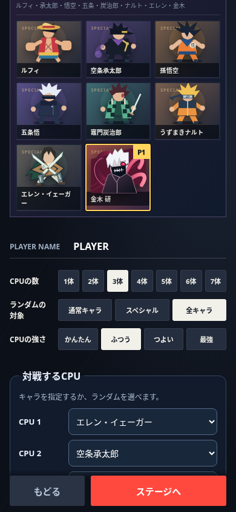

# CPU戦・トレーニングの相手指定

キャラ選択画面の「対戦するCPU」から、相手キャラを指定できる。

- CPU戦：人数に応じてCPU 1〜7を個別指定。同じキャラの複数指定や、指定とランダムの混在も可能。
- トレーニング：練習相手1体を指定。CPU戦の指定とは別に保持する。従来の停止/通常/最強の操作を維持する。
- 「ランダム」の枠のみ、既存の通常キャラ/スペシャル/全キャラの対象設定から抽選する。明示指定は全19キャラから選べる。
- 人数を一時的に減らしても各枠の指定を残し、ステージ選択から戻っても失わない。設定は現在のページ内で保持し、再読み込み後の保存は行わない。
- オンライン・組み手・トーナメントの相手選択や戦闘中の相手変更は今回の対象外。無効な指定はランダムへ戻す。

## 検証

`npm run build`、`npm run check`、`npm test`：全181件成功。

専用テストで個別指定、プレイヤー/チームの維持、練習設定の独立、ランダム対象、不正/古い指定のフォールバック、最大7体・同キャラ・混在、組み手への非干渉を検証。

`node scripts/benchmarks/cpu-selection-browser.cjs`：既存のブラウザー検証と同じチェックアウト外のPlaywright/p5、ローカル静的サーバーを使用。PC 1280×900/タッチ付き390×844で、タイトルからモード・自キャラ選択、CPU指定、人数の増減、ステージから戻る、対戦開始まで確認。CPU戦は金木/エレン/承太郎/悟空、練習は金木/エレンで指定どおりに開始。実行時エラー・横はみ出し0。実スマホでのネイティブ選択メニューは未検証。

