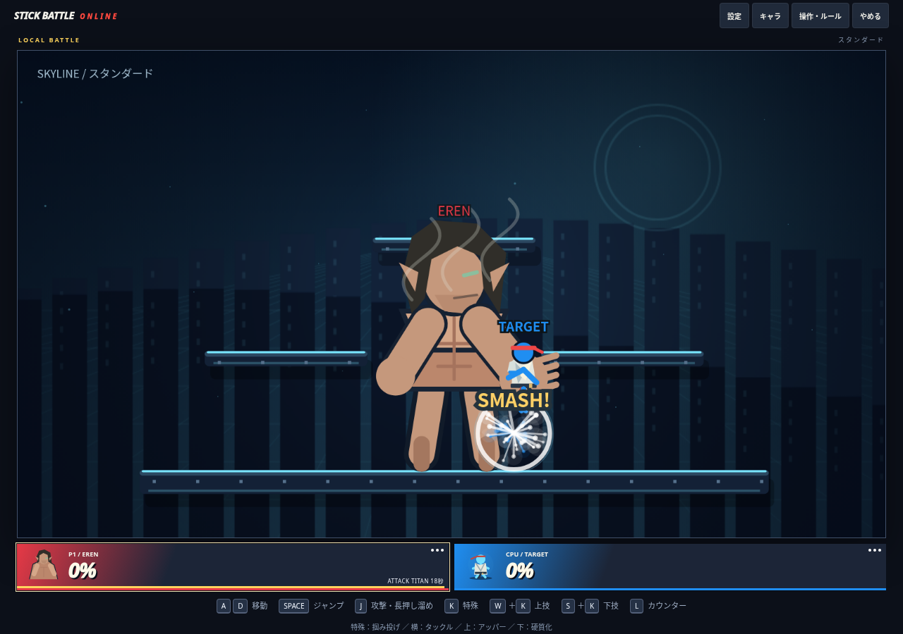
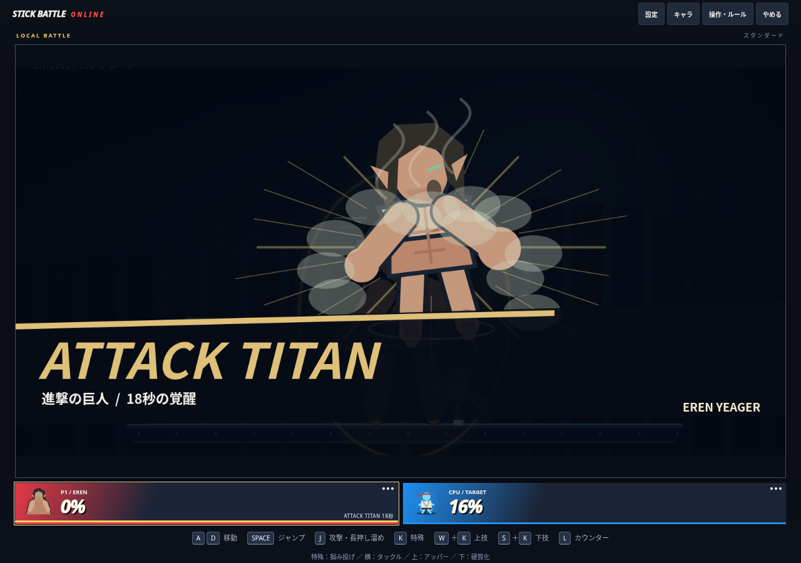
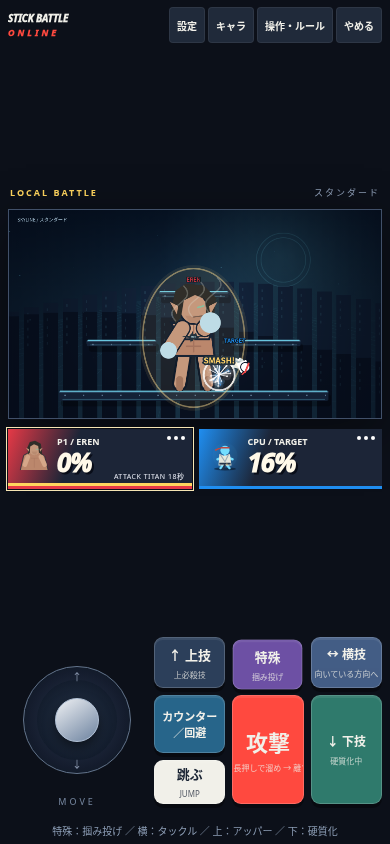

# エレン：添付仕様対応・レビュー結果

作業開始時の最新main `e9442f1` から新規ブランチ `feat/eren-spec-completion` を作成。今回の[添付仕様](specs/EREN_REQUEST_2026-10-28.md)を優先した。**mainへのマージ・ゲーム公開は行っていない。** 公開中の前版の記録は [EREN_FREEDOM_REWORK.md](EREN_FREEDOM_REWORK.md)。

主要機能を実装・検証したが、実オンライン対戦、実機性能、対人バランスと見た目の最終評価が残る。完成条件をすべて達成したとの判断はしていない。

## 調査結果と今回の変更

前版は人間の通常特殊が双剣4連斬、巨人の通常特殊が薙ぎ払い、下特殊が地砕きであり、添付仕様とは異なっていた。硬質化も下特殊ではなくカウンター時の短い補助だった。今回はワイヤーフック・掴み投げ・120フレーム硬質化へ割り当てを変更した。新しい専用ボタンは追加していない。

既存のCHARS、MOVE_DEF、60Hz固定更新、所有者側の攻撃確定、Firebaseイベント/スナップショット、共通CPUと覚醒カットインを利用する。固有処理は引き続き `14-eren.js` に置き、攻撃判定・命中位置の通信・拘束表示のみ既存コードへ接続した。

## 技と形態の現在仕様

| 入力 | 人間 | 巨人 |
|---|---|---|
| 通常攻撃 | 双剣5×2＝10 | 左右交互の拳14 |
| 溜め攻撃 | 回転斬り10〜16、回転モーション | 鉄拳18〜28、16フレーム発生、全体54、腕を引く予備動作 |
| 通常特殊 | 足場へワイヤーフック、ガスで牽引 | 近距離掴み、24フレーム拘束から20ダメージの投げ |
| 横特殊 | ワイヤー急襲14、接続成功時のみ発動、後隙あり | タックル18、踏み込みと土煙、後隙あり |
| 上特殊 | 上の足場への復帰、空中1回 | 対空アッパー18 |
| 下特殊 | ゲージMAXで変身 | 硬質化120フレーム、再使用360フレーム、被ダメージ30%軽減 |
| カウンター/回避 | 共通ルールとガスの表現 | 共通ルール。掴みも正面カウンター可能 |

前版の飛行中の操舵、再接続、攻撃への切替、ジャンプ離脱、入力を離した際の減速は維持した。ワイヤーは実在する足場へ最大440の範囲で接続し、最大48フレーム、再接続8フレーム間隔。ガス上限100、接続14、維持0.16/フレーム。空中斬撃命中で同じ振り・対象につき6回収し、着地で2.5/フレーム補充する。アンカーがない場合は空中加速や代替攻撃を発生させない。

人間の速度倍率1.20、重量係数1.05。巨人は描画3倍、速度.82、ジャンプ.78、吹っ飛び係数.40。硬質化中は速度.48、特殊技不可、溜めも終了42フレームの通常拳へ制限する。巨人でも被弾・カウンター・KO・落下は有効。

## 巨人化・ゲージ・表示

- ゲージ100。通常命中+6、強攻撃命中+10、被ダメージ×2。自然蓄積なし。多段・重複通知は攻撃IDと相手IDで加算を制限する。遅延した命中通知は発生時の技記録から加算量を決める。
- 18秒＝1080回の戦闘更新。変身演出、全体フリーズ、時止め、試合停止では時間を進めない。巨人中は再蓄積しない。
- 前版から、被弾中もMAXなら変身できる操作と、変身時の一度の衝撃波16/半径190、演出後90フレームの無敵を維持。味方・防御・無敵の既存ルールを通す。
- 時間切れでゲージ0、蒸気と24フレームの巨人残像、60フレームの疲労。その後通常操作へ復帰する。
- KO時に形態・ワイヤー・硬質化・拘束を初期化。次の残機は獲得済みゲージを最大50まで保持し、最終KO・新試合は0。
- HUDは人間のTITAN GAUGEから巨人の残秒へ切替。残り3秒以下は警告色。硬質化と再使用秒数は既存の下技ボタンへ表示する。

## 描画・判定・演出

巨人の被弾判定は幅90・高さ225の専用矩形。拳・鉄拳・掴み・タックル・アッパーはそれぞれの実座標の射程・高さ・半径を `EREN_TITAN_HITS` に設定し、描画の拳の位置にも利用する。通常キャラの判定式は変えていない。うなじは背後上部の小さな領域、倍率1.2。実際の近接命中位置を通信し、相手の攻撃アニメーション受信が遅れてもうなじ判定を維持する。

覚醒は手を噛むポーズ→黄金の落雷→煙と巨体→上体を反らした咆哮ポーズ・合成低音→ATTACK TITAN。全体フリーズと共通の黒帯・形態名表示を維持し、光刺激抑制設定にも対応した。鉄拳命中時のオフライン8フレームのヒットストップ、衝撃リング・振動も維持する。オンラインでは独自の全員停止を増やさない。

巨人の顎を簡略化した図形で追加し、長髪・耳・拳・蒸気を維持した。人間の衣装とポートレートは既存の調査兵団風の装備を利用。原作画像・音声・映像・BGMの取り込みはない。以下はローカル検証画面の実スクリーンショットであり、実オンライン対戦の証拠ではない。

## 再現・修正した不具合

1. **復活後の再掴み不能**：以前は攻撃IDが `id:round:swing` で復活後に再使用された。新しい残機・再初期化の世代をIDへ含め、以前掴んだ相手も再び掴める。古い世代の掴みは拒否する。
2. **味方の影分身を掴み判定で消せる**：味方判定より先に分身を消していた。味方・無敵・攻撃者を検証してから敵分身を消す。
3. **遅延命中のゲージ加算違い**：通知時に別の技へ移ると、その技の種類で加算していた。上限128件の技記録から元の攻撃種類を参照する。
4. **通信中のうなじ追加ダメージが欠落**：攻撃者の表示アニメーションに依存していた。命中時の座標を受け手へ伝える。
5. **掴み表示の位置・落下ずれ**：相手が手の上に立ち、さらに遠隔表示の重力予測で下がって見えた。相手の胴体を手へ合わせ、観戦側も巨人の補間位置から拘束位置を描く。攻撃者が時止め・領域・被弾などで中断された場合は拘束解除する。

## CPU・オンライン互換性

人間の急襲、巨人の拳・掴み・タックル・対空・硬質化を共通AIへ登録。変身は距離・ダメージ・残機差だけでなく足場の幅と左右の余裕を確認する。タックルも踏み込み先が足場内に収まる場合を優先する。CPU専用の技性能や専用入力はない。

形態・ゲージ・残時間・硬質化・ワイヤー・ガス・解除演出・攻撃世代・拘束を既存スナップショットで同期。掴み開始・投げは被弾者の所有端末で確定し、変身は既存シネマティックを使う。値は既知のフィールドへ制限して復元する。プロトコルは `SBO_NET_EREN_SPEC_V36`。将来公開する際には参加者全員の再読み込みと新規ルームが必要。

## 検証結果

- `npm run build` / `npm run check` / `npm test`：成功。114件成功、失敗・スキップ0。
- 既存18キャラの移動・ジャンプ・各攻撃、モード進行、カウンター、チーム保護、影分身、入力、通信の回帰試験は成功。
- Erenの新仕様、1080フレームと停止、解除復帰、復活後再掴み、古い世代拒否、味方分身、掴みカウンター、硬質化制限、遅延通知、通信うなじ座標、遠隔拘束位置、全ステージの足元接地を検証。
- p5 1.9.0とChromium、1280×900とタッチあり390×844。ブラウザのキー/タッチイベントから固定更新を進め、通常フック、横急襲、再接続、斬撃切替、離脱、下特殊変身、掴みと20ダメージ投げ、硬質化120/360、解除後復帰を確認。手噛み・稲妻・咆哮・形態名・光刺激抑制の各画面を確認。実行時エラー0、スマホ相当の横はみ出しなし。
- ブラウザ検証は外部Firebase/CDNを除いたローカルページで行った。リポジトリの `index.html` は正規ビルドのまま。
- `node scripts/benchmarks/eren.mjs`：既存17キャラ×2シード、3ストック、スタンダード、上限3600フレーム。16勝18敗、時間切れ0、変身19回。前版は31勝3敗・変身8回。仕様に沿ったダメージ・技構成へ変えた結果であり、強さや楽しさの完成判定には使わない。結果は `eren-spec-results.json` と `eren-results.json`、前版は `eren-freedom-results.json`。
- `node scripts/benchmarks/eren-stress.mjs`：巨人形態を含む1/7 CPUを1200フレーム実行し、数値破綻0。Node VMで約157/502ms（描画・通信を除く、FPS保証ではない）。固定シードで再実行可能。
- GitHub CIのpush対象へ `feat/**` を加え、今回のレビュー用ブランチでもビルド整合性と全自動テストを実行する。

## 未検証・残課題と次の優先順位

1. **実Firebaseの対戦**：2端末以上で変身・掴み・投げ・解除、切断・再接続・通信遅延を通して確認する。2クライアント模擬通信の成功を実通信の成功と同一視しない。
2. **操作感・対人バランス**：今回は仕様書を優先して通常特殊をワイヤー、巨人通常特殊を掴み、下特殊を硬質化へ戻した。以前の連斬・薙ぎ払い・地砕きが好まれるかを含め、対人で評価する。少数シード・単一ステージの勝率だけでは判断できない。
3. **大型の身体と足場**：全ステージの足元接地は自動確認済みだが、上体と上段足場の視覚的重なりは残る。ゲームには固体壁や天井衝突がなく、一方向足場の既存仕様を維持している。全ステージの実プレイ・狭い足場でのカメラと見やすさは未検証。
4. **実機性能・音**：実スマホ、実ゲームパッド、描画・通信込みの8人性能、合成咆哮の音質は未評価。自滅率・復帰成功率・技別命中率も独立集計していない。
5. **演出・外見の最終品質**：原作らしさ・見た目の納得感と爽快感は画像や自動テストだけで保証できない。レビューで実際の操作と見え方を評価する必要がある。

## 主な変更ファイル

- `src/game/14-eren.js`：技、状態管理、世代ID、専用判定データ、CPU、描画、演出、操作表示。
- `src/game/08-combat.js` / `05-network-sync.js`：専用の拳判定と実命中座標の受け渡し。
- `src/game/13-ui-and-menus.js`：拘束表示、硬質化時の遠隔攻撃時間、プロトコル。
- `tests/eren.test.mjs`：仕様更新と回帰試験。`index.html` はビルド生成。
- `scripts/benchmarks/`：再現可能な負荷試験、バランス試験結果。`.github/workflows/verify.yml`：作業ブランチCI。
- このレビュー文書、添付仕様の保存、実画面画像、READMEの案内。
