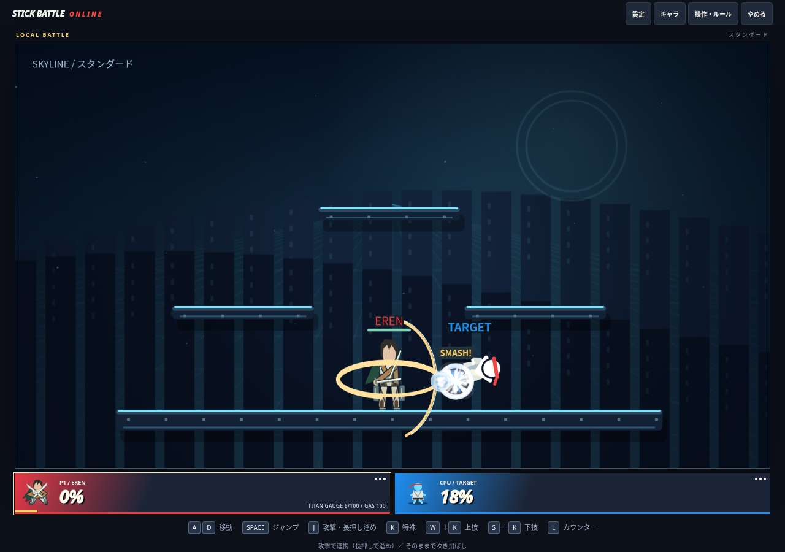
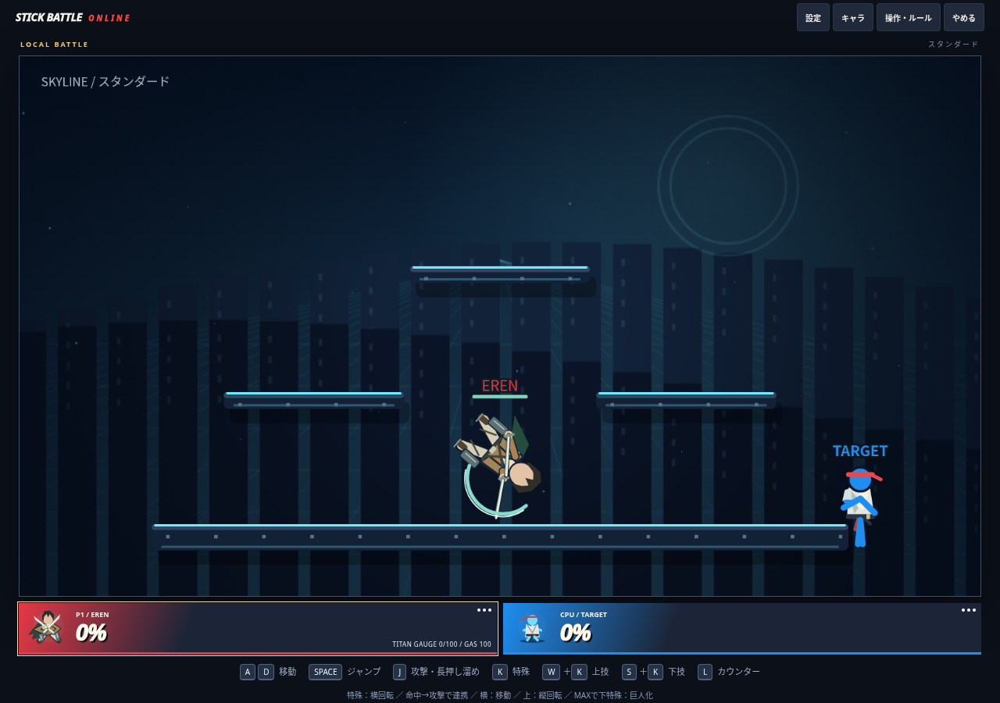

# エレン：回転斬りの連携と立体機動の速度調整

最新main `f965267` から `feat/eren-spin-combos` を作成。後続のユーザー指示に合わせ、人間形態の操作を変更した。以前の仕様書より今回の操作感の要望を優先する。巨人の技・形態時間・硬質化の性能は変えていない。

## 現在の操作と狙い

| 入力 | 動作 |
|---|---|
| 特殊 | 横回転斬り。前後を斬り、出し切れば強く吹き飛ばす |
| 横特殊 | ワイヤーで移動しながら斬り込む。移動の主力 |
| 上特殊 | 低い縦回転斬り。ワイヤー急上昇は行わない |
| 特殊命中→攻撃をタップ | 出始めから双剣攻撃へ連携 |
| 特殊命中→攻撃を長押し | 溜めへ移り、離して回転斬り。最大溜めでフィニッシュ |
| 下特殊 | 従来どおりゲージMAXで巨人化 |

基本の流れは **横特殊で接近 → 特殊で横回転 → 攻撃で追撃**。連携を入力せず特殊を出し切っても、最後にスマッシュ扱いの吹き飛ばしが発生する。敵を通り過ぎた場合も回転斬りは背後へ当たり、追撃時は入力方向を優先し、方向入力がなければ命中した相手へ向き直る。

## 性能・入力

- 横回転斬り：発生5、最初の斬撃4ダメージ、13フレーム目の締め14ダメージ、全体30フレーム。締めは範囲も広げ、最初の斬撃で相手が少し吹き飛んでも届くようにした。締めはheavyで正面カウンター可能。
- 追撃：攻撃入力を最大18フレーム先行受付。実際に命中を確認し、7フレーム目以降、技が終わるまでは双剣／溜めへ移行できる。空振りやアーマーに当たっただけの場合はこの追撃キャンセルを許可しない。特殊の再使用時間は残し、被弾すると入力予約を破棄する。同時押しやスマホの短いタップも受け付ける。
- 通常の最大溜め回転斬り：16→22ダメージ、最大吹っ飛ばし基礎値12→18。溜めが浅ければ威力は低く、CPUの威力評価も実際の溜め時間へ合わせた。
- 横特殊：速度上限24相当から12、牽引加速2.4→1.1、上向き速度上限22→8、持続48→26フレーム。再接続間隔8→14フレーム。射程の目安280→210。
- 接続先は同じ高さを優先し、足場端から最大48内側へ寄せる。到達時に減速し、操作を離した人が勢いだけで端から落ちるケースを抑える。手動のジャンプ離脱・空中操舵・再接続は残す。
- 接近斬撃の吹き飛ばしも抑え、横回転へつなぐ前に相手が遠くへ飛んでしまわないようにした。
- 縦回転斬り：5×2ダメージ、発生4、全体28フレーム、空中1回。上昇速度は5.5。元のワイヤー上昇の勢いや、W＋Kで同時に入る通常ジャンプも引き継いで高く上がらない。接続先・ガスは不要。
- ワイヤー中から特殊を入力すると切り離して横回転、上特殊なら縦回転へ切り替える。専用の横技ボタンはスティックを上下へ向けても移動技として扱う。
- 横回転は水平の斬撃リング、締めは大きな金色の斬撃、縦回転は身体の回転で区別する。強い斬撃の命中に振動と衝撃波、オフラインでは4フレームのヒットストップ。オンラインへ独自の全員停止は追加しない。
- 命中時は操作案内を「攻撃で連携」、溜め中は「離して回転斬り」に切り替える。

## 検証

`npm run build` / `npm run check` / `npm test` 成功。**130件成功、失敗・スキップ0**。

新規・更新試験で、地形なしの横回転、前後への命中・吹き飛ばし方向、出し切り18ダメージ、実際の相手の吹き飛び後も締めが届くこと、移動→特殊→攻撃の連携、タップ／長押し／同時入力、空振り・被弾によるキャンセル制限、締めのカウンター、縦回転の上昇制限、移動上限、離した後の接地、スマホの方向指定、遠隔アニメーションのheavy段階、CPUの溜め威力を確認。既存キャラ・モード・巨人化・掴み・硬質化・通信等の試験も成功。

Chromium＋p5 1.9.0、PC 1280×900・タッチあり390×844でブラウザ入力を確認。PCの特殊出し切り18ダメージと特殊→双剣、スマホの横技→特殊→攻撃で23ダメージを確認した。上技ボタンの最大上昇は22.5。横はみ出しなし、実行時エラー0。描画はローカル配信で確認し、実Firebase通信とは区別している。

前版 `f965267` と同じ位置・スタンダードで移動を比較。敵の操作や攻撃は加えず、横はD＋Kを30フレーム、上はW＋Kを60フレーム入力。KO時はそこで計測を止め、下記の上昇量はKO前までの最大値。座標はゲーム内単位で画面のCSSピクセルではない。

| 計測 | 前版 | 調整後 |
|---|---:|---:|
| 横・最高水平速度 | 約22.99 | 12 |
| 横・最大上昇 | 約316.65 | 約5.18 |
| 横・この入力でのKO | 29フレーム目に発生 | なし |
| 上・最大上昇 | 約687.75 | 22.5 |
| 上・この入力でのKO | 34フレーム目に発生 | なし |

再現用：`node scripts/benchmarks/eren-mobility.mjs`。前版の作業ツリーを引数に渡すと前後を比較できる。結果は `eren-spin-mobility-results.json`。右へ歩き続けて落ちるなど、全入力・全地形での落下を禁止したものではない。

既存17キャラ×2シードの模擬戦は17勝17敗、時間切れ0、変身19回。前版は16勝18敗。結果は `eren-spin-results.json` と `eren-results.json`。勝率のみで操作の楽しさや対人バランスの完成とは判断しない。

1/7 CPUを含む1200フレームの模擬実行は数値破綻0。Node VMで約54/205ms。描画・通信を含まないため、実機FPSの保証ではない。

## 互換性と残る確認

- 既存17キャラと巨人形態の技性能は維持。共有判定には横回転の吹き飛ばし方向だけを追加した。CPUと人間は同じ性能・入力ルールを使う。
- 新しい技を同期するためプロトコルを `SBO_NET_EREN_SPIN_V37` へ更新。公開後は全員再読み込み・新規ルームが必要。
- 実オンラインの遅延下での命中確認と追撃の感触、実スマホ／ゲームパッド、描画込みの多人数性能、全地形での復帰は未検証。
- 自滅率・復帰成功率の全体集計や、「ちょうどよい速度」「決め技の気持ちよさ」の対人評価は今後確認する。CPUは新技を評価するが、今回の追撃入力を専用に計画するAIは追加していない。
- 主な変更は `14-eren.js`、Erenだけの速度制限を加えた `07-movement.js`、吹き飛ばし方向の `08-combat.js`、遠隔表示・プロトコルの `13-ui-and-menus.js`、回帰試験・比較スクリプト・生成HTML。
