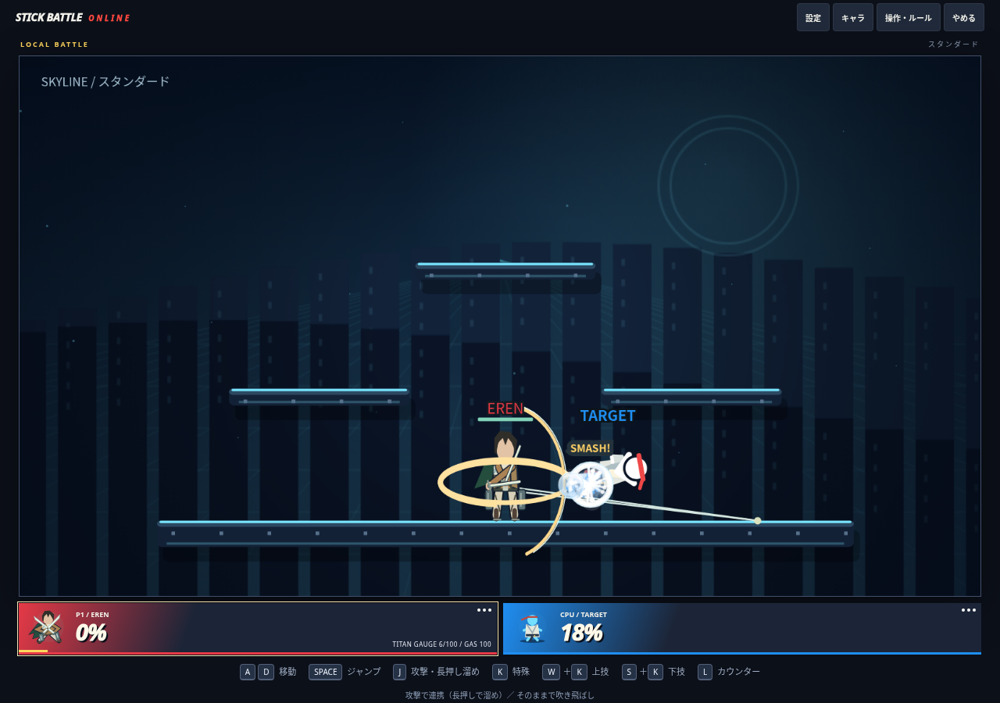

# エレン：上昇量・ワイヤー継続・立体機動の微調整

最新main `382e00b` から `feat/eren-wire-flow` を作成。回転斬りと追撃の操作は維持し、最新の操作感フィードバックへ対応した。

| 項目 | 前版 | 今回 |
|---|---:|---:|
| 上特殊の上昇速度 | 5.5 | 7.5 |
| 上特殊の最大上昇量・標準地上 | 22.5 | 約43.2 |
| 横特殊の速度上限 | 12 | 14 |
| 牽引加速 | 1.1 | 1.25 |
| ワイヤー継続上限 | 26フレーム | 42フレーム（約0.7秒） |
| 再接続間隔 | 14フレーム | 12フレーム |

通常特殊の横回転斬りでも、実在する足場へ2本のワイヤーを出す。横特殊から通常特殊へ切り替えた場合は接続先を引き継ぐ。攻撃用ワイヤーは回転斬りの姿勢を支える表現で、追加のガス消費・牽引・上昇は与えない。牽引移動は横特殊を使う。足場がない場所でも斬撃・追撃は使える。

横特殊は到達した瞬間に切断せず、接続したまま減速する。到着後は突進中の低摩擦も解除し、線が残っていても加速し続けない。ジャンプで解除でき、到着後の地上ジャンプは通常の跳躍量を保つ。時間切れ、のけぞりを伴う被弾、無効になった足場、巨人化などでは線を解除する。

上特殊の空中1回制限、急上昇の抑制、通常特殊の命中確認→攻撃／溜め、出し切り18ダメージ、最大溜め22ダメージ、巨人の技・18秒・硬質化は維持する。

## 検証

- `npm run build` / `npm run check` / `npm test` 成功。135件成功、失敗・スキップ0。
- 通常特殊の接続と斬撃維持、余計な移動が生じないこと、到着後の接続継続と減速、42フレームでの失効、到着後の地上ジャンプ、攻撃用ワイヤーの状態復元・不正な足場・期限切れ・被弾解除を追加検証。
- PCとタッチありスマホ相当のChromiumで、通常特殊のワイヤー、出し切り18ダメージ、接近→特殊→双剣の連携23ダメージ、上技の約43.2の上昇を確認。実行時エラー0、横はみ出しなし。外部Firebaseを使わないローカルページでの入力・描画確認。
- `eren-mobility.mjs`：横技30フレームの最高速度14・上昇約5.18、上技60フレームの最大上昇約43.2。いずれもこの入力ではKOなし。全地形・全入力での自滅率の測定ではない。
- 既存17キャラ×2シードの模擬戦は18勝16敗、時間切れ0、変身19回。前版は17勝17敗。結果は `eren-wire-flow-results.json` と `eren-results.json`。
- 1/7 CPUを1200フレーム実行して数値破綻0。Node VMで約63/217ms。描画・通信を含まないため実機FPSは未検証。

攻撃用ワイヤーと到着状態を制限付きスナップショットで復元する。プロトコルは `SBO_NET_EREN_WIRE_FLOW_V38`。公開後は全員の再読み込みと新規ルームが必要。

実オンラインの通信遅延・再接続、実スマホ・ゲームパッド、描画込みの多人数性能、操作感の対人評価は引き続き未検証。既存17キャラの技性能は変更していない。

主な変更は `14-eren.js`、到着後の減速だけを変更した `07-movement.js`、プロトコルの `13-ui-and-menus.js`、回帰試験、生成HTML、検証結果・文書。
