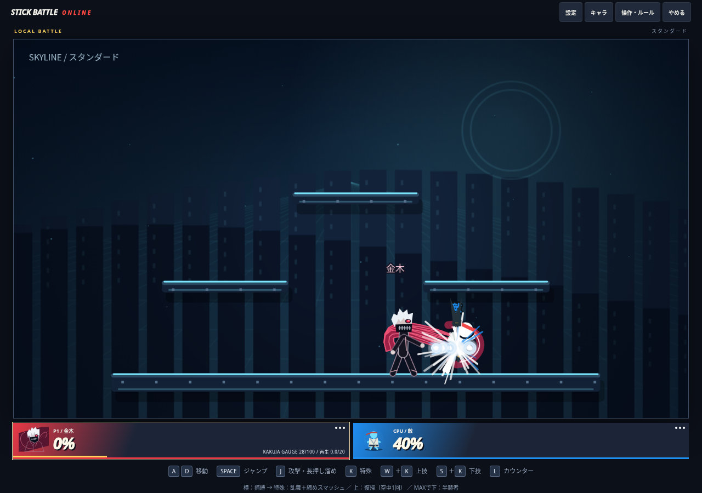

# 金木：乱舞の締めスマッシュと上特殊の復帰強化

公開済みmain `189b1b5` を基点に改修。旧仕様の技表より本記録を優先する。

## 操作

- **横特殊で捕縛→特殊で乱舞→自動で締めスマッシュ**。特殊を連打しても乱舞を最初からやり直さず、最後まで出し切る。別の専用ボタンは不要。
- 通常乱舞：6×3＋最終14＝最大32。最終段は4本の赫子を束ねて強く吹っ飛ばす。半赫者乱舞は5×5＋最終16＝最大41。最終段には短い持続と大きい判定を持たせた。
- 締めは蓄積ダメージによる通常の吹っ飛ばし。固定KO・必中・無敵はない。無敵/チーム/カウンターを維持し、同じ段階の二重命中を拒否。音・振動・太い斬撃を追加し、オフラインだけ5Fのヒットストップを使う。
- 上特殊は方向入力付きの復帰技。通常の上昇初速-16、半赫者-18、上昇量は無障害時に約205/261。左右入力で進行方向へ寄せる。旧通常の初速-11.5から上昇量を増やした。
- 空中1回、着地で再使用可。通常/横特殊の再使用待ちが残っていても、動作可能なら上特殊を使用できる。被弾・硬直を無条件にキャンセルする技ではなく、無限上昇や新しい無敵を付けない。CPUも同じ入力ルールで復帰する。

## 検証

- `npm run build` / `npm run check` / `npm test`：全176件成功。
- 最終段の威力と吹っ飛ばし・連打による中断防止・防御との相互作用、崖下復帰・着地での回数回復・覚醒中の上昇量・CPU入力を追加検証。
- 2所有端末の模擬通知で、最終段14ダメージと吹っ飛ばし、重複拒否、攻撃者への確認が成功。受信側も共通の技定義を使用し、送信データで威力やKOフラグを増やせない。
- PCキー/スマホ相当ポインターの実入力で、選択→捕縛8→特殊連打→締め（累積40）→上特殊を確認。足場より100下から上特殊で戻り着地し、復帰回数が回復することを確認。実行時エラー・横はみ出し0。
- エレン巨人・半赫者を含む2/8体1200Fの模擬負荷で数値破綻0。結果は `scripts/benchmarks/kaneki-finish-stress-results.json`。描画/通信込みの実機性能ではない。
- 実Firebaseの遅延・切断/再接続と実スマホ/ゲームパッド、全ステージの崖際・対人バランスは未検証。連携後にすべての技が必ず当たるとは保証しない。

プロトコル `SBO_NET_KANEKI_FINISH_V42`。公開反映時は全員再読み込み・新規ルームが必要。待機時の赫子固定と既存のエレンの技性能は維持した。

