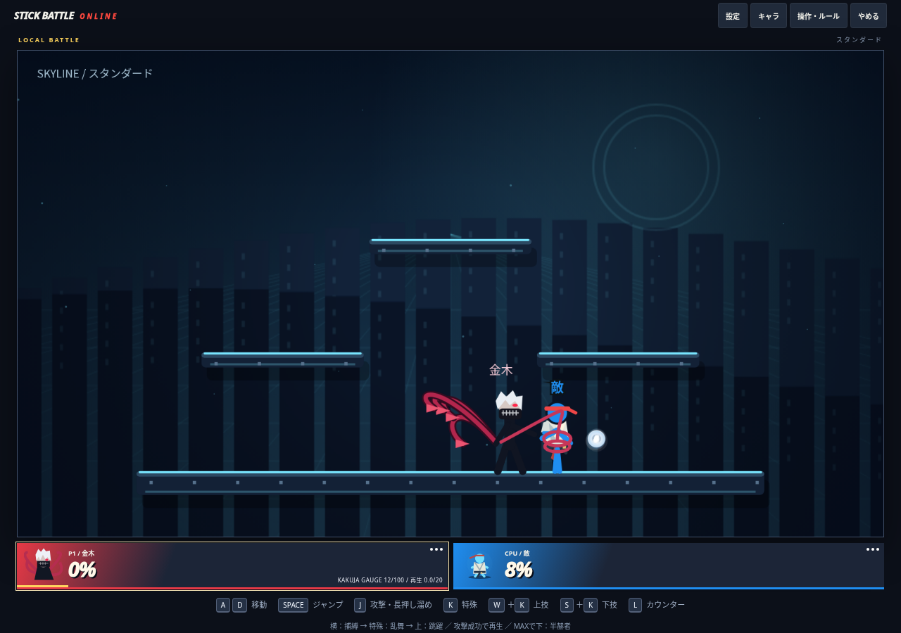
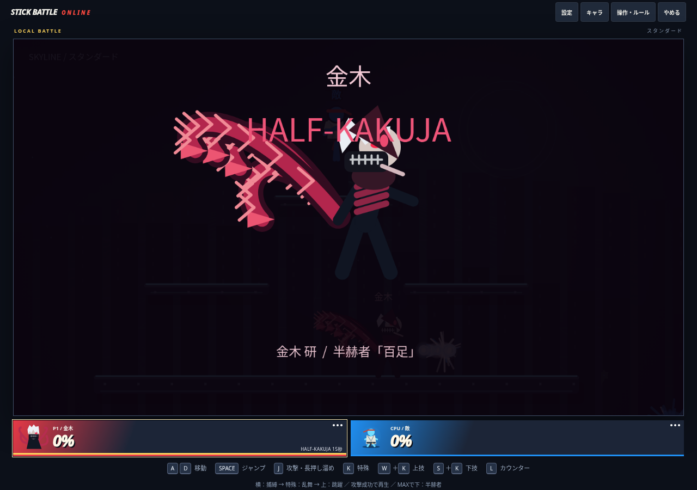
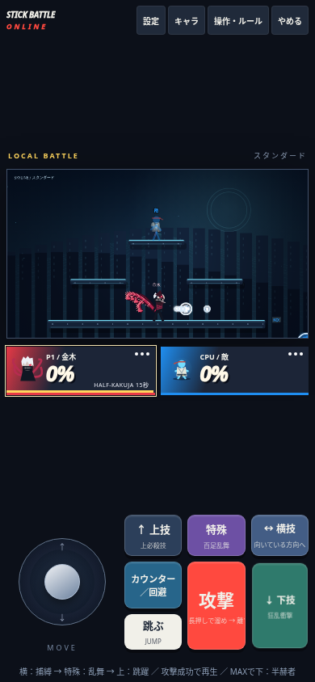
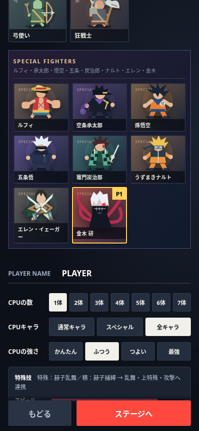

# 金木研：白髪・鱗赫・半赫者「百足」

最新main `bd6c7a6` を基点に `feat/kaneki-rinkaku-kakuja-implementation` で実装。既存の同名に近いブランチは上書きせず、エレンの `14-eren.js` は変更していない。[依頼仕様](specs/KANEKI_REQUEST.md)を保存した。mainへのマージ・本番公開は実施しない。

## 操作と実装

白髪、赤い赫眼、歯のマスク、黒衣、独立して揺れる4本の曲線鱗赫を持つSPECIALキャラ。新しいボタンは不要。専用処理は `src/game/15-kaneki.js`。既存の所有端末による命中確定、通常の蓄積％・吹っ飛ばし、カウンター・回避・CPU入力を利用する。

| 操作 | 白髪金木 | 半赫者「百足」 |
|---|---|---|
| A | 赫子打撃 8 | 狂乱打撃 5×2 |
| 溜めA | 四尾穿突 15〜25 | 百足・貫穿 20〜30 |
| B | 赫子乱舞 6×4 | 百足乱舞 5×6 |
| 横B | 赫子捕縛 8、短時間の引き寄せ | 百足急襲 5×4、方向入力による接近 |
| 上B | 赫子跳躍 13 | 百足跳躍 16 |
| 下B | MAXで半赫者へ覚醒 | 狂乱衝撃 23、予備動作22F・再使用300F |

鱗赫の攻撃部分と身体の被弾判定は独立。乱舞は段階別の命中管理で一対象につき4回/6回まで。最終段は通常の吹っ飛ばしを強くする。固定撃墜・完全追尾・常時無敵はない。巨人エレンの技や移動・ジャンプ設定を変更しない。

### 捕縛・連携

横Bは発生10F・攻撃終了48F・特殊再使用80F。1回の射出で1体のみ。相手の所有端末で命中・18F以内の引き寄せを確定する。1Fの移動は横9・縦6以内。回避・無敵・味方・カウンターを維持し、アーマー、大型の身体、巨人エレン、覚醒金木には打撃のみ。対象には120Fの再捕縛防止を置く。

命中した技に限り終盤に10Fの入力バッファを使える。横B→B→上B、攻撃/溜めへの入力が可能。全段の確定命中は保証しない。通常入力の回数制限・被弾解除・空振りの隙を維持する。CPUも遅延観測・難易度判断と同じ入力を使い、命中を確認したときのみ連携を試す。

### 再生・覚醒

再生は有効な攻撃3回で2%。多段・複数対象・重複通知は同じ攻撃のカウントを増やさない。6秒の再使用間隔、1ストック実回復20%上限、0%以下に減らさない。回復とゲージは金木の所有端末だけが確定する。ストック変更で予算・古い命中記録を初期化する。

通常命中はゲージ12、乱舞は16、被ダメージ×0.4。3秒ごとに乱舞を一度成功させる条件では21秒でMAXになるが、実戦の20〜30秒到達を保証するものではない。模擬戦では覚醒頻度が低く、継続調整が必要。

下Bで900回の戦闘更新＝15秒の覚醒。演出・時止め・試合停止中は消費しない。半赫者は前傾姿勢、異形マスク、外殻、節と脚のある百足状の鱗赫になる。移動倍率1.24、各技も切替。吹っ飛び係数1.18の弱点と通常の被弾・KOは維持する。終了後24Fの疲労、ゲージ0。覚醒中は再蓄積しない。

### 通信

プロトコル `SBO_NET_KANEKI_V41`。採用後は全員再読み込み・新規ルームが必要。

技の世代・攻撃ID・段階を既存命中通知に載せ、被弾者側で重複段階を拒否。受信側は既知の技定義からダメージと吹っ飛ばしを制限し、固定KOフラグ等を採用しない。確認通知は対象の所有者からのみ受け入れる。形態・残時間・ゲージ・実回復量・再生CD・捕縛を制限付きスナップショットで復元する。捕縛は被弾、消滅、KO、対象/術者の形態変更、時間切れで解除。切断時は既存の参加者削除に伴う術者不在で解除する。

## 検証

- `npm run build` / `npm run check` / `npm test` を実行。全167件成功（既存のエレン等を含む）。金木固有24件と既存19キャラの回帰試験。
- 金木固有試験：多段上限、通常吹っ飛ばし、捕縛・空振り・再捕縛防止・被弾/消滅/変身解除、アーマー/カウンター/巨人、再生上限/実回復量、900Fと停止、空中復帰制限、KO初期化、受信値制限、不正送信者、2所有端末の模擬通信。
- Chromium+p5 1.9.0、PC 1280×900とタッチあり390×844。実キー/ポインターから横B（8ダメージ・捕縛）→B（累積32）→上Bへ連携、下Bで覚醒を確認。実行時エラー0、横はみ出し0。外部Firebaseへの要求は遮断したローカル描画検証。
- `node scripts/benchmarks/kaneki.mjs`：既存18キャラ×2シード、左右交代、標準ステージ、3ストック、上限3600F。結果は `scripts/benchmarks/kaneki-results.json`。8勝28敗・時間切れ0・覚醒4回。少数シードのCPU試験であり、対人バランスや操作感の完成判定には使わない。
- `node scripts/benchmarks/kaneki-stress.mjs`：エレン巨人と金木半赫者を含む2/8体・1200Fの模擬負荷。数値破綻0。描画・通信を除くため実機FPSを示すものではない。

ブラウザー再現（任意、リポジトリ依存追加なし）：`npm install --prefix /workspace/kaneki-tools --no-package-lock playwright`、TLS検証を維持してp5 1.9.0を `/workspace/kaneki-tools/p5.min.js` へ取得。チェックアウトで `python3 -m http.server 8000 --bind 127.0.0.1` を起動し `node scripts/benchmarks/kaneki-browser.cjs`。システムの `/usr/bin/chromium` を使用。画像出力はチェックアウト外の `/workspace/kaneki-tools`。

## 残課題

- 実Firebaseを使う2端末の遅延・切断/再接続検証。模擬通信の成功と区別する。
- 実スマホ・実ゲームパッド、描画と通信込みの8人性能。
- 全ステージ・崖際の連携と復帰、対人バランス・音・原作らしさと爽快感の最終評価。
- CPUは負け越し。捕縛からの連携は使用するが、実戦のゲージ到達頻度と対遠距離キャラの駆け引きを継続調整する。

主要機能は実装したが、すべての完成条件を検証済みとは扱わない。

## 選択画面の修正

初回公開時、SPECIALの表示順リストに金木がなく、登録・CPUプールには存在しても選択カードが出なかった。表示リストと見出しへ追加した。ブラウザー回帰検証はタイトル→CPU戦→SPECIAL全8体のカード確認→金木クリック→選択状態・説明表示まで通す。PC・スマホ相当で成功し、その後の捕縛連携・覚醒も再確認した。

