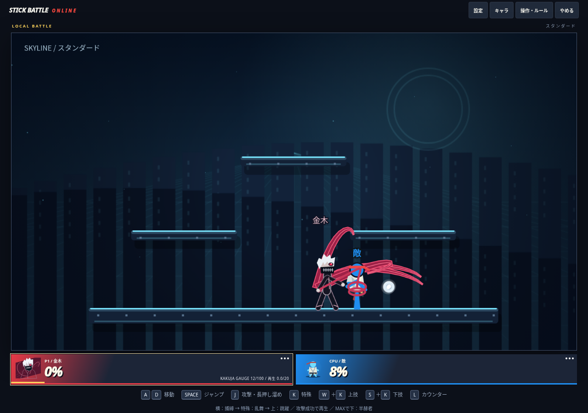
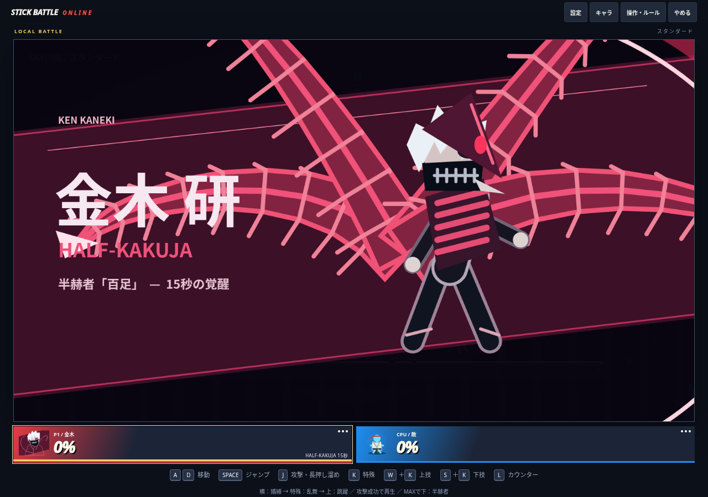
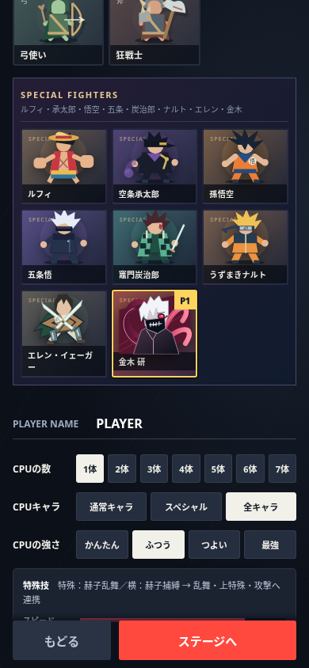

# 金木：待機揺れの撤廃と演出の強化

公開済みmain `dee49cf` が基点。ユーザーの「地味」「赫子をゆらゆらさせない」という指摘に対応した。

- 赫子の時刻による揺れ・移動速度によるたわみを削除。待機は通常/半赫者ごとの固定構え。
- 固定の曲線と先端・百足の節を2組のPath2Dに保持して再利用。毎フレームの待機用三角関数・曲線形状生成・画像転送はしない。攻撃時だけ決められた技フレームに沿って動かす。
- 攻撃時は先細りの赤黒いリボン、明るい稜線、突き・乱舞・捕縛・斬り上げ・範囲攻撃の異なる軌道と白い斬撃を追加。4本同時に無制限の粒子を出す演出は追加しない。
- 黒衣の輪郭、白髪、赤い赫眼、マスクの歯、手足、半赫者の外殻を描き直す。
- 選択ポートレートを刷新。覚醒は斜めの赤黒い帯、大きな金木、広がる百足、「金木 研 / HALF-KAKUJA」の専用カットインへ変更。光刺激抑制の設定を尊重する。
- ダメージ・入力・当たり判定・再生・タイマー・通信形式・エレンのコードは変更していない。待機ポーズのための通信データ追加はない。

## 検証

`npm run build`、`npm run check`、`npm test`：全169件成功。待機が時刻・移動速度で変わらないこと、形状計算でスナップショットが変わらないこと、乱舞各段で1本ずつ攻撃姿勢になることを追加検証。

PC/タッチ付きスマホ相当のChromiumで、選択画面の金木クリック、横特殊→乱舞→上特殊、覚醒の実入力と描画を再確認。実行時エラー0、横はみ出し0。実Firebase対戦は実施していない。

### 描画コストの測定と限界

`scripts/benchmarks/kaneki-render-cost.cjs` と結果JSONを保存。実行には既存ブラウザー確認と同じチェックアウト外のPlaywright/p5、ローカル静的サーバーが必要。比較元を `git show dee49cf:index.html > /workspace/kaneki-tools/kaneki-before.html` で用意し、`node scripts/benchmarks/kaneki-render-cost.cjs`。固定ポーズの金木8体・30描画×5回の中央値を記録する。毎描画で画面を消去し、小領域のCanvas読み戻しで実処理を待つ比較であり、ゲーム本体のFPSやオンライン通信性能ではない。

8体1描画のstroke呼出は通常152→88、半赫者712→112。待機の曲線座標生成はキャッシュ作成時のみ。ただしこの環境の読み戻し込み30描画では、通常約89→162ms、半赫者180→217msと増加した。見た目を強化した版について総描画コスト削減の達成は主張しない。実機スマホ・描画/通信込み8人戦での性能確認と、必要に応じたさらに軽い描画は残課題。

待機揺れが通信遅延の原因だったという証拠はない。描画変更が通信遅延を解消したとは扱わない。

