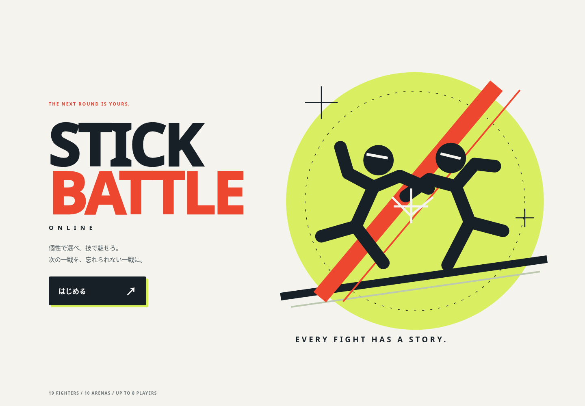
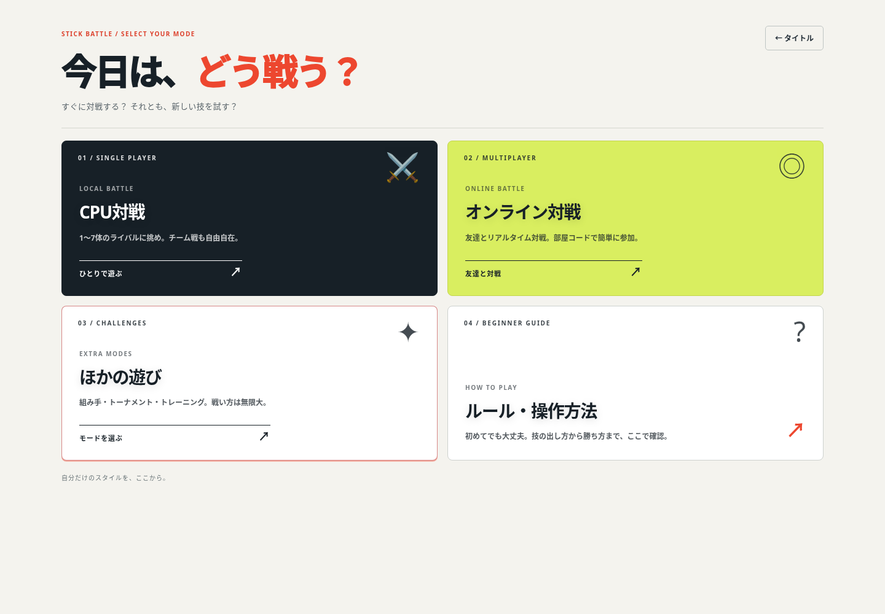
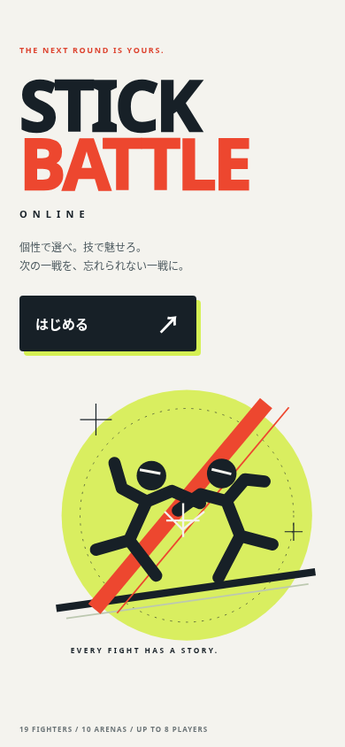
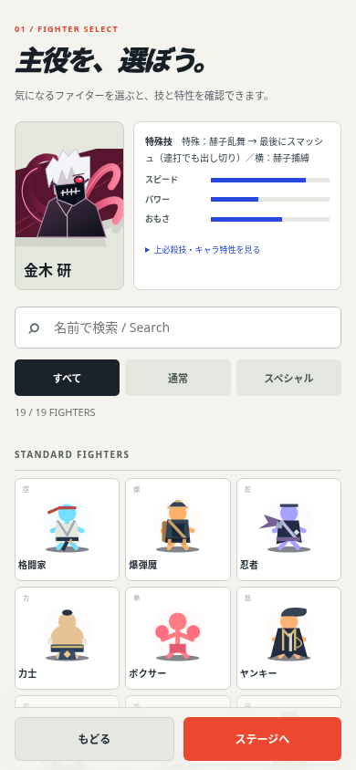
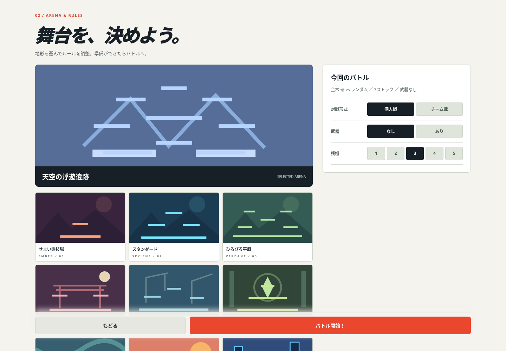

# タイトルから対戦準備までのUI刷新

公開main `c4ff76a` を基点に変更。今回はユーザーの依頼に従い、PRで記録した後にmain反映・公開まで行う。

## デザインと操作

暗いグラデーション中心の画面から、オフホワイト・墨色・朱色・ライムのポスター調へ変更。静的なオリジナルSVGの対戦イラスト、大きなロゴ、明確な開始ボタン、登録データに追従する人数/ステージ数表示を用意した。外部画像・フォント・待機アニメーションの追加はない。

- モード：CPU/オンラインを主要な入口とし、ほかの遊び・操作説明を同じカード体系へ統一。タイトルへ戻れる。
- キャラ：選択中の姿と技・能力を並べ、検索（日本語/英語/全角英字）、通常/スペシャルの絞り込み、件数と空結果の案内を追加。全19キャラを維持。選択状態は色とチェックで示す。
- キーボード：フォーカス可視化、左右キー/Home/Endでカード移動、Enterで選択。選択でカードが再描画されてもフォーカスを戻す。画面遷移時は見出しへフォーカスし、スクロールを先頭に戻す。
- CPU指定/練習相手・名前・難易度設定を新しい配色に統一。
- ステージ：選択した地形の大きなプレビュー、全10マップの一覧、現在の使用キャラ/相手/残機/武器/チームの確認欄を追加。ルール変更時も確認欄を更新。
- 小画面：横はみ出しを防ぎ、キャラを3列・説明をコンパクト表示。次へ/開始を画面下に固定して長い一覧からも進める。
- 操作説明・オンライン入口・追加モードにも配色と操作部品を適用。

`src/styles/menu-v2.css` と `src/game/16-menu-ui.js` に主に集約。テンプレートへ検索・プレビュー領域を追加し、manifestと生成HTMLを更新した。バトルHUD・技・命中/通信処理は変更していない。

## 検証

- `npm run build`、`npm run check`、`npm test`：188件成功。
- `node scripts/benchmarks/menu-browser.cjs`：1440×1000 / 390×844 / 320×740 / 844×390でタイトル→モード→キャラ→ステージを確認。検索、空結果と復帰、絞り込み、全19キャラ、キーボード選択、プレビューと設定確認欄、戻る、操作説明、オンライン入口、ソロトーナメント開始前の対戦表を確認。実行時エラー・横はみ出し0。
- `node scripts/benchmarks/cpu-selection-browser.cjs`：PC/スマホ相当でCPU個別指定・練習相手指定から開始まで成功。
- `node scripts/benchmarks/kaneki-browser.cjs`：PC/スマホ相当で金木選択→捕縛→乱舞→締め、上特殊の復帰、覚醒を確認。
- ブラウザー試験は既存のPlaywright/p5・システムChromiumとローカル静的サーバーを使い、Firebase通信を遮断。実機スマホ・実オンライン対戦そのもの・スクリーンリーダーの実利用は未検証。

