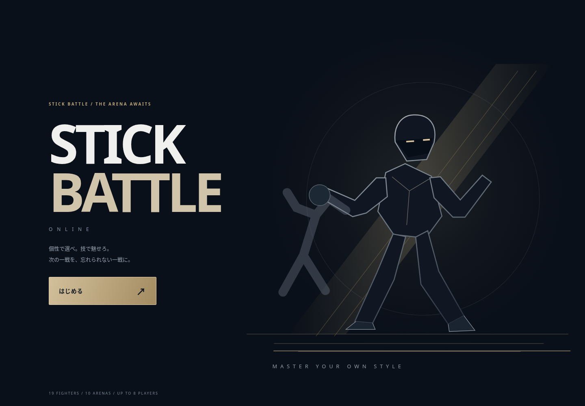
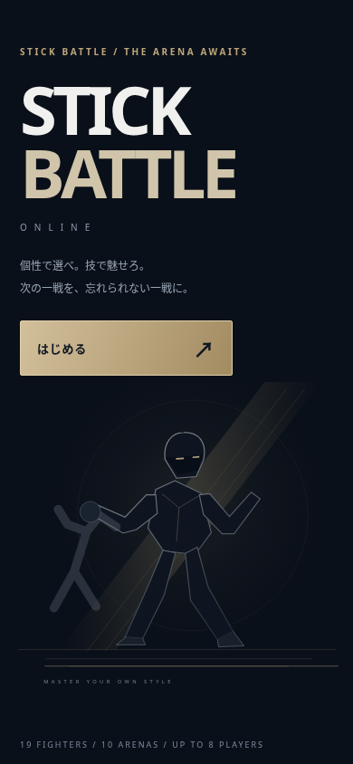
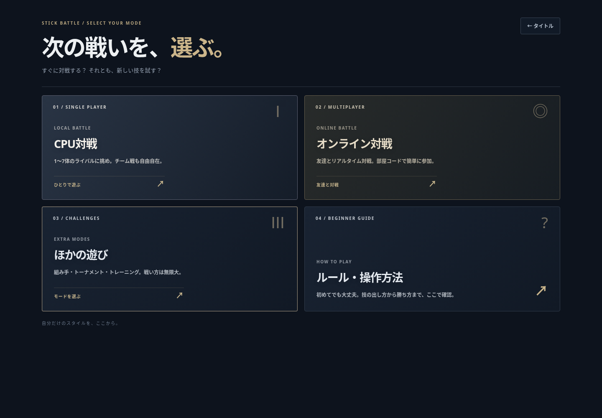
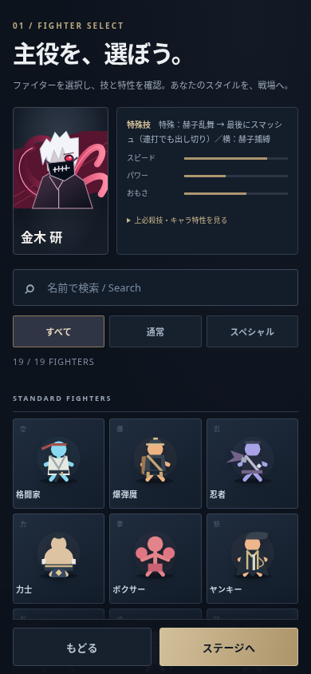
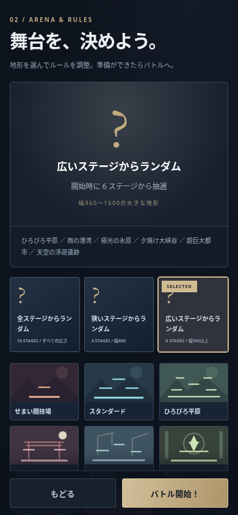

# 濃色UIと広さ別のステージ抽選

公開main `770c1f5` から改修。前回のポップなポスター調を、ミッドナイト/プラチナ/シャンパンゴールドへ変更。絵文字調の記号と明るい配色を撤去し、静的な新しいタイトルイラスト、薄い境界、抑えた装飾、文字の太さと余白で統一した。外部画像・フォント・継続する待機アニメーションは追加していない。

## ステージ選択

固定10ステージに加え、3種類の抽選をCPU戦・練習・組み手・ソロ大会・オンラインのステージ設定へ追加。

| 選択 | 対象 |
|---|---|
| 全ステージからランダム | 全10種類 |
| 狭いステージからランダム | ワールド幅800以下：せまい闘技場、スタンダード、月夜の社、動力炉（4種類） |
| 広いステージからランダム | 幅800超（現行960〜1600）：ひろびろ平原、雨の港湾、極光の氷原、夕焼け大峡谷、超巨大都市、天空の浮遊遺跡（6種類） |

プレビューに対象名・件数・幅の基準を表示する。画面の表示サイズやステージ名の印象では分類しない。通常の固定指定は抽選しない。

- CPU戦・練習・組み手の新規開始/再戦時に実在マップを1回抽選。選択方針は別に保持するため再戦でもランダムを維持する。組み手の一連の対戦中は同じステージ。
- ソロ大会は対戦表を作るときに抽選して大会中固定。
- オンラインはホストが抽選し、実在するmap IDを全参加者へ共有。端末ごとには抽選しない。オンライン大会は最初に決めたマップを大会中固定する。
- ランキングや試合詳細には方針名ではなく実際のmap IDを保存する。
- 通信プロトコル `SBO_NET_ARENA_RANDOM_V44`。公開後は全員再読み込み・新規ルームが必要。

## 検証

`npm run build`、`npm run check`、`npm test`：194件成功。プールの分類/網羅性、乱数の端、固定指定、再戦、練習、大会の固定、オンラインホストの共有・大会固定を追加検証。

- `node scripts/benchmarks/menu-browser.cjs`：PC 1440×1000、スマホ相当390×844、小画面320×740、横画面844×390で検索・絞り込み・キーボード選択・プレビュー・各モードの導線を確認。横はみ出し・実行時エラー0。
- `node scripts/benchmarks/random-arena-browser.cjs`：PC/スマホ相当で3種すべてを実UIから選び、抽選範囲内の実マップで対戦開始することを確認。プレビューの対象表示も確認。
- CPU個別指定・練習相手、金木の捕縛→乱舞→締め、復帰、覚醒の既存ブラウザー試験も成功。
- ブラウザー試験ではFirebase通信を遮断。オンラインは模擬ルームでホストの書き込みを検証したもので、実Firebase対戦・実機端末・対人バランスを検証済みとは扱わない。

